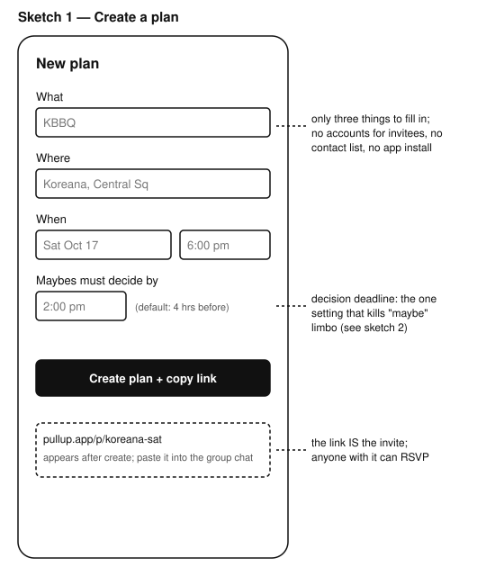
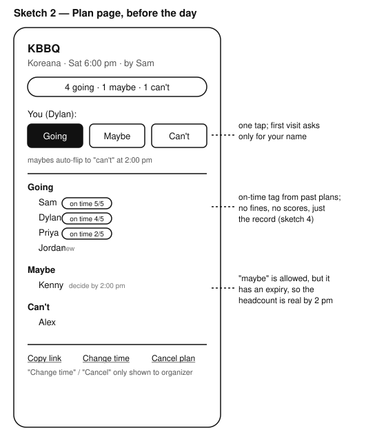
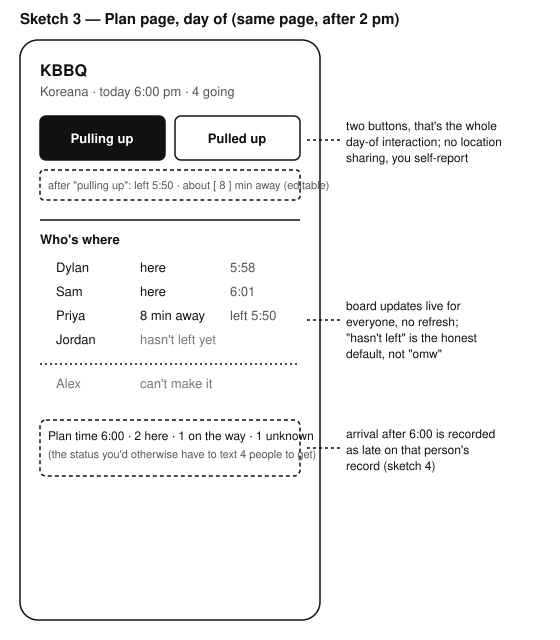
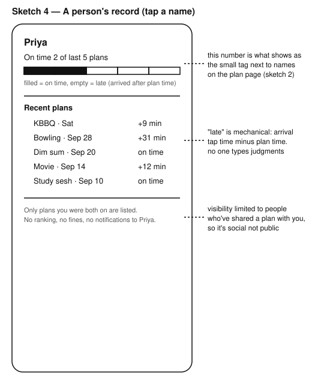

# UI sketches

Low-fidelity, monochrome. Error handling and sign-in are omitted. The whole app is basically one page (the plan page) that looks different before and on the day of the plan, plus a create form and a record page.

## 1. Create a plan

## 2. Plan page, before the day

## 3. Plan page, day of

Same page as sketch 2; after the decide-by time passes, the RSVP buttons are replaced by the pulling up / pulled up buttons and the list becomes the status board.

## 4. A person's record

Reached by tapping a name on the plan page.

