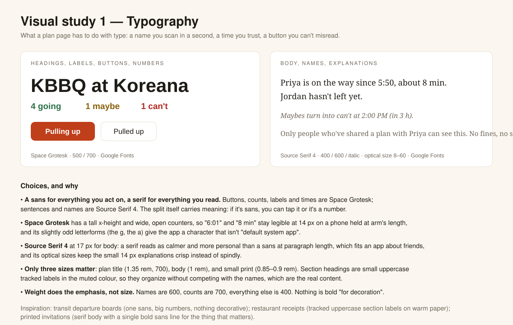
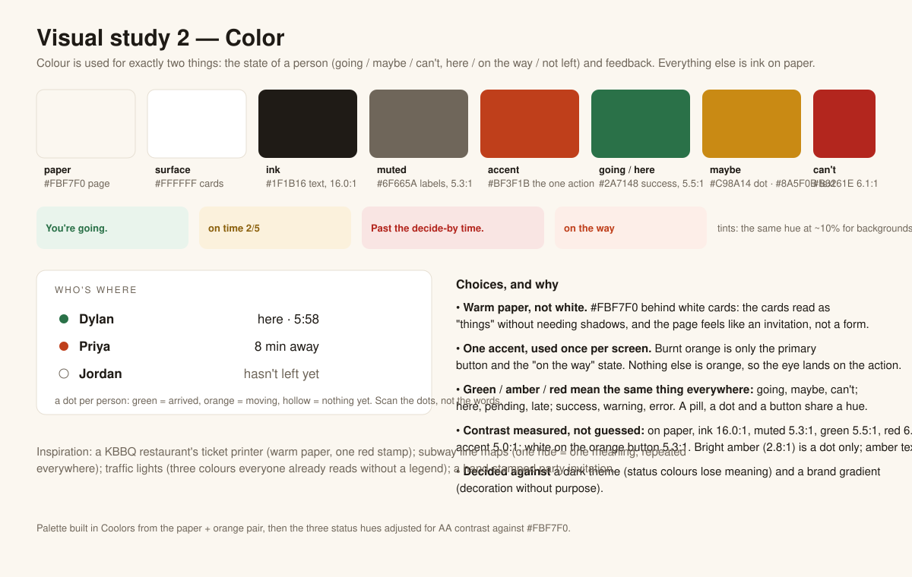

# Visual design study

Two slides, one on typography and one on colour, with the choices annotated in the margins and the reasons each choice made it into the interface. The slides are SVG so they render on GitHub.

## Slide 1: Typography

**What made it into the app.** Two faces, with a rule for which is which: Space Grotesk for anything you act on or compare (buttons, counts, times, labels, pills), Source Serif 4 for anything you read (names, sentences, explanations). Three sizes: plan title, body, small print. Section headings are small tracked uppercase labels in the muted colour, so they organize the page without competing with the names, which are the content. Emphasis comes from weight, not size.

## Slide 2: Colour

**What made it into the app.** Warm paper behind white cards, near-black ink, one accent (burnt orange) reserved for the primary action and the "on the way" state. Green, amber and red carry exactly one meaning each and carry it everywhere: going/maybe/can't on the response buttons and pills, here/moving/late on the board, success/warning/error in feedback. Contrast of every text colour was measured against its background (the numbers are on the slide) and all of it meets WCAG AA for normal text. The first draft failed twice: the bright amber was unreadable as text (2.8:1) and white on the first orange was 4.1:1, so amber is now a dot colour only with a darker amber for amber text, and the orange was deepened a step. Two things were tried and dropped: a dark theme, because the status colours lost their meaning on dark grey, and a gradient header, because it was decoration without a job.

## How style carries meaning on the plan page

- The response buttons take the colour of the state you picked (green Going, amber Maybe, red Can't) and are plain outlines otherwise, so your own answer is visible from across the room.
- The board uses a dot per person: filled green for here, filled orange for on the way, hollow for hasn't left. The words repeat the dot for people who can't see colour.
- Feedback sits in a tinted strip under the counts: green tint for "You're going", red tint for a refusal, with the sentence saying what to do next.
- Order of operations is the vertical order: what the plan is, whether you're coming, the day-of buttons, who's where, everyone's responses, share, and organizer controls last, separated by the uppercase section labels.
